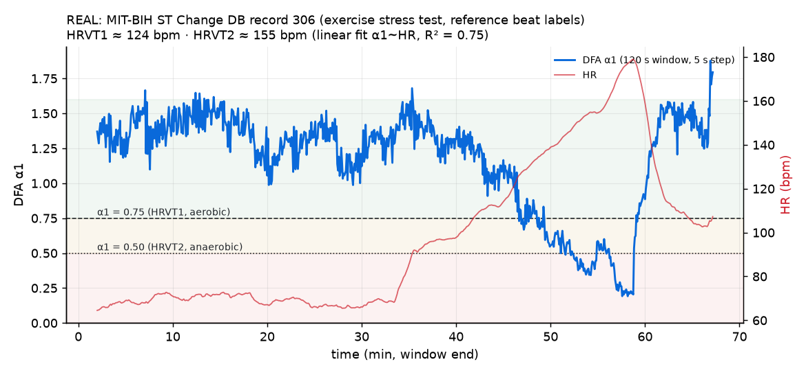
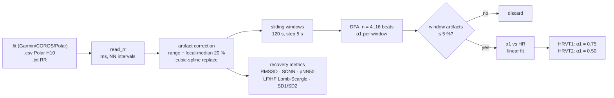
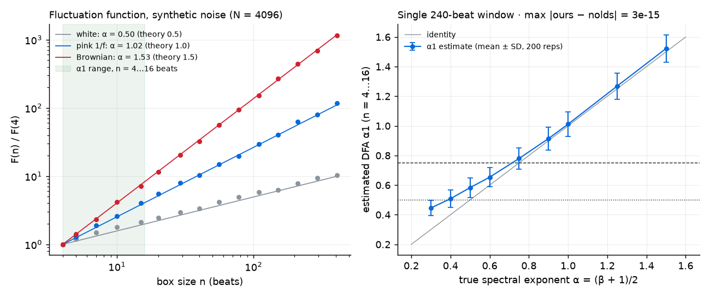
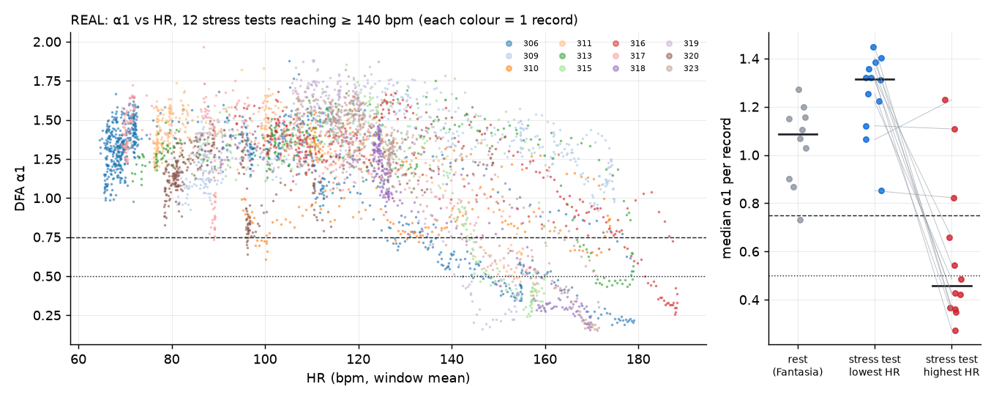
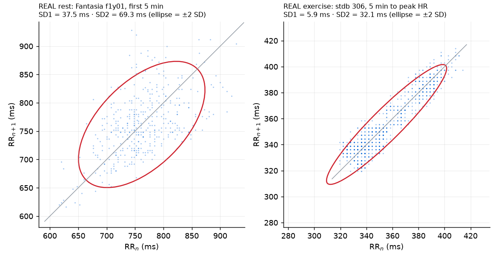
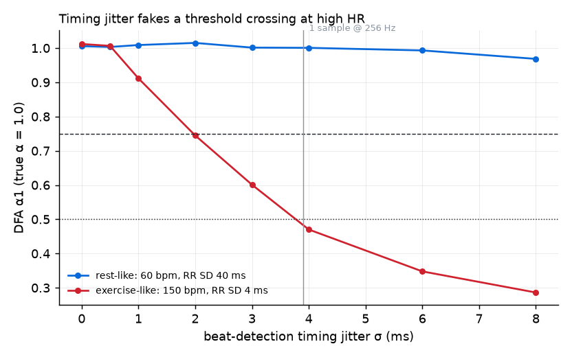

# hrv-threshold

**DFA-α1 from RR intervals, with the validation shown.** It estimates the aerobic (α1 = 0.75) and anaerobic (α1 = 0.50) HRV thresholds from a chest-strap or ECG recording, and computes the standard recovery metrics (RMSSD, SDNN, pNN50, Lomb–Scargle LF/HF, Poincaré SD1/SD2).




<sub>Real data: MIT-BIH ST Change Database record 306, an exercise stress test with reference beat annotations (PhysioNet, ODC-BY). α1 is computed in 120 s windows every 5 s. HRVT1 and HRVT2 come from a linear α1~HR fit on the ascending limb only.</sub>

---

## Why I built this

<!-- TODO(Tommaso): dictate 3-4 lines in your own words -->

---

## What it does



```bash
python -m venv .venv && . .venv/bin/activate
pip install -e ".[fit]"          # add [validate] to rerun the PhysioNet checks

hrv-threshold alpha1 ride.fit --thresholds --plot alpha1.png --csv alpha1.csv
hrv-threshold metrics morning_h10.txt --json --plot poincare.png
hrv-threshold alpha1 examples/synthetic_ramp.txt --thresholds   # bundled synthetic demo
```

```python
from hrvthreshold import read_rr, alpha1_timeseries, estimate_thresholds, all_metrics
rr = read_rr("ride.fit")                       # ms
s = alpha1_timeseries(rr)                      # 120 s / 5 s windows
v = s.valid(max_artifacts=0.05)
th = estimate_thresholds(s.alpha1[v], s.hr[v])
print(th.hrvt1, th.hrvt2, th.r2, th.reliable)
```

**Inputs.** `.fit` files are read with `fitdecode`. Beat intervals live in the `hrv` message (`time`, up to five RR values per message, `65.535 s` means invalid); turn on HRV/RR logging on the watch and pair a chest strap. CSV/TXT can hold one RR per line (ms or s, auto-detected) or a table with an `RR`/`IBI` column, such as Polar Sensor Logger's `Phone timestamp;RR-interval [ms]`.

---

## The math

### DFA (Peng et al., 1995)

Take $N$ RR intervals $x_1,\dots,x_N$ with mean $\bar x$.

**1. Integrate.** Build the profile, a random-walk embedding of the series:

$$
y(k) = \sum_{i=1}^{k} \left( x_i - \bar x \right), \qquad k = 1,\dots,N
$$

**2. Box.** Split $y$ into $N_n = \lfloor N/n \rfloor$ non-overlapping boxes of $n$ beats each.

**3. Detrend.** Inside each box $\nu$, fit a least-squares line $\hat y_\nu(k) = a_\nu k + b_\nu$ (DFA-1).

**4. Fluctuation function.** Take the RMS of the residuals over all retained samples:

$$
F(n) = \sqrt{ \frac{1}{N_n\, n} \sum_{\nu=1}^{N_n} \sum_{k \in \nu} \bigl( y(k) - \hat y_\nu(k) \bigr)^2 }
$$

**5. Scale.** For a self-similar signal $F(n) \propto n^{\alpha}$, so $\alpha$ is the ordinary least-squares slope

$$
\alpha = \frac{\sum_j (u_j - \bar u)(v_j - \bar v)}{\sum_j (u_j - \bar u)^2}, \qquad u_j = \log n_j,\; v_j = \log F(n_j)
$$

**α1** is that slope over the short-term scales $n \in \{4, 5, \dots, 16\}$ beats, the Kubios convention that the threshold papers use.

Reading α: $0.5$ means uncorrelated (white noise), $1.0$ means $1/f$ (pink, healthy resting heart), $1.5$ means Brownian. Values below $0.5$ mean anti-correlated fluctuations. For a $1/f^{\beta}$ spectrum, $\alpha = (\beta+1)/2$.

### Windowing and thresholds

The windows follow Rogers et al. (2021, *Front. Physiol.*): **120 s windows, recomputed every 5 s**. Windows are defined in time, so a window holds about 120 beats at 60 bpm and about 340 at 170 bpm. Thresholds come from an OLS regression $\alpha_1 = a\,\mathrm{HR} + b$ over windows with $0.25 \le \alpha_1 \le 1.05$:

$$
\mathrm{HRVT1} = \frac{0.75 - b}{a}, \qquad \mathrm{HRVT2} = \frac{0.50 - b}{a}
$$

A fit is flagged `reliable` only if $R^2 \ge 0.5$ and neither threshold is extrapolated outside the observed HR range.

### Recovery metrics

These follow the Task Force (1996) definitions: $\mathrm{RMSSD} = \sqrt{\langle (x_{i+1}-x_i)^2 \rangle}$, $\mathrm{SDNN}$, and $\mathrm{pNN50}$. For Poincaré, $\mathrm{SD1}^2 = \tfrac12 \mathrm{Var}(\Delta x)$ and $\mathrm{SD1}^2 + \mathrm{SD2}^2 = 2\,\mathrm{Var}(x)$. LF (0.04–0.15 Hz) and HF (0.15–0.40 Hz) come from a **Lomb–Scargle** periodogram computed directly on the unevenly sampled tachogram, with no resampling. The PSD is Parseval-scaled so that $\int P\,df = \mathrm{Var}$ of the linearly detrended series, which gives absolute powers in ms².

---

## Why α1 falls with intensity

- At rest, healthy beat-to-beat dynamics are close to fractal, with α1 ≈ 1 (Peng et al., 1995). In young adults resting supine, short-term scaling sits near 1 (Iyengar et al., 1996, which is also the source of the Fantasia data used below).
- As intensity rises, vagal withdrawal and growing sympathetic drive break those correlations. α1 falls through 0.75 and on toward 0.5 (uncorrelated) and below (anti-correlated). Gronwald, Rogers & Hoos (2020) propose α1 as a marker of intensity distribution for this reason.
- Rogers et al. (2021, *Front. Physiol.*) matched α1 = 0.75 to the first ventilatory threshold, and Rogers et al. (2021, *JFMK*) matched α1 = 0.50 to the second. Both studies compared against gas exchange.
- One subject in the field recordings below (s1, light cycling at HR 84–106 bpm) has α1 of 1.43–1.60, well above 1. Treat that as an observation in this dataset, not a general claim.

---

## Validation

There are three independent verifiers. Everything below is reproducible: run `pytest` for (a) and (b) on synthetic data, and `python scripts/validate_physionet.py && python scripts/make_figures.py` for (c), which needs network. Raw numbers are in [`results/`](results/).

### (a) Synthetic signals with known exponent



| signal (N = 4096, 50 reps) | theory | α1 (n = 4–16) | wide range (n = 4…409) |
|---|---|---|---|
| white noise | 0.50 | **0.59 ± 0.02** | 0.52 ± 0.02 |
| pink 1/f | 1.00 | **1.02 ± 0.02** | 0.99 ± 0.02 |
| Brownian | 1.50 | **1.50 ± 0.02** | 1.49 ± 0.03 |

The +0.09 on white noise is not a bug. It is the known small-scale bias of DFA-1 (Kantelhardt et al., 2001). The bias shrinks over the wide range, and it is part of how the 0.75/0.50 cut-offs were calibrated, because Kubios α1 uses the same estimator. The right panel shows the full calibration curve for a single 240-beat window (2 min at 120 bpm). The **single-window SD is 0.05–0.09**, which is why thresholds should come from a regression over many windows, never from one window. Pytest tolerances: α1 range white ±0.10, pink and Brownian ±0.06; wide range ±0.05.

### (b) Cross-check against an independent implementation

With `overlap=False`, linear detrending and an OLS fit over n = 4…16, [`nolds`](https://github.com/CSchoel/nolds) `dfa` is the same estimator. Agreement:

- synthetic, 15 configurations (α 0.3–1.5, N 150–1000): **|Δα| < 1e-9** (tested in CI)
- **every valid window checked on all 38 real PhysioNet records** (up to 20 per record): **max |Δα| = 8.2e-15**

### (c) Real public data: rest vs exercise

| dataset | what | n | result |
|---|---|---|---|
| [Fantasia](https://physionet.org/content/fantasia/1.0.0/) (doi:10.13026/C2RG61) | young adults, 2 h supine rest, reference beat labels | 10 | α1 = **1.05 ± 0.17** (range 0.73–1.27) |
| [MIT-BIH ST Change DB](https://physionet.org/content/stdb/1.0.0/) (doi:10.13026/C2ZW2H) | exercise stress tests, reference beat labels, NN only | 12 reaching ≥ 140 bpm | α1 at lowest-HR decile **1.25** → highest-HR decile **0.59**; drop > 0.2 in **9/12**; median Spearman ρ(α1, HR) = −0.53 |
| same, threshold fits | ascending limb, reliable fits only | 7 / 12 | median HRVT1 = **89 % of peak HR**, HRVT2 = **95 %** |



What this data does and does not show:

- **It shows** the expected behaviour on real, expert-annotated ECG. α1 sits around 1 at rest, and in most stress tests it falls through 0.75 and 0.5 as HR rises.
- **It does not validate threshold accuracy.** These are clinical stress-test patients, not athletes. The records carry no gas-exchange reference (VT1/VT2), the protocols and medication are undocumented, and peak HR is not necessarily HRmax. Three records reach high HR with no α1 decline (309, 310, 320), and the reliability gate rejects their fits.
- The ST Change DB is sampled at 360 Hz, so RR values are quantized to 2.8 ms (≈ 0.8 ms RMS timing error). Next to the 5.9 ms SD1 at peak HR in record 306, that error is small, but it is not zero (see the jitter section below).
- Validating HRVT1 and HRVT2 needs simultaneous RR and VO₂ data. That is the obvious next step; contributions with open data are welcome.



### Field ECG: the detector matters as much as the DFA

The [Wrist PPG During Exercise](https://physionet.org/content/wrist/1.0.0/) set (doi:10.13026/C2PQ1X) has a chest-ECG lead recorded during walking, running and cycling, but **no beat labels**. I compared two R-peak detectors on the same signal: `wfdb` XQRS, and a band-pass (8–30 Hz) detector with an adaptive threshold and parabolic sub-sample refinement.

- **Usable records:** the band-pass detector produced at least one valid window (≤ 5 % artifacts) on 15/19 records; XQRS on 11/19. During running and walking, motion artifacts made several recordings unusable for either detector.
- **Disagreement:** on 3 records (s2_low_resistance_bike, s5_low_resistance_bike, s5_run) the two detectors' median α1 differs by more than 0.15.
- **Same HR, different α1 (s5_run):** both detectors give HR 124 bpm with < 1 % artifacts. α1 is **1.00** with the band-pass detector and **0.61** with XQRS.

The explanation is timing jitter. An error $e_k$ on beat times adds $e_{k+1} - e_k$ to every RR interval, which is anti-correlated noise. At exercise HR the true RR fluctuations are only a few ms, so a few ms of jitter is enough to push α1 below 0.75.



At 150 bpm with an RR SD of 4 ms, timing jitter of σ = 2 ms takes a true α = 1.0 down to **α1 ≈ 0.74**: a phantom aerobic threshold. At rest, where the RR SD is 40 ms, the same jitter does nothing. One sample at 256 Hz is already 3.9 ms.

---

## Limitations

- **Sensor.** Use a chest strap or ECG. Optical PPG pulse-arrival times carry far more timing jitter than R peaks, and the jitter section above shows how that biases α1 low exactly where thresholds live. Rogers et al. (2021, *Sensors*) studied how device type and artifact correction change α1.
- **Artifacts.** The correction here is a **simple, documented** rule (physiological range plus 20 % deviation from an 11-beat local median, cubic-spline replacement). It is **not** the Lipponen & Tarvainen (2019) beat-classification algorithm behind Kubios "automatic" correction, so expect small differences from Kubios on dirty data. Windows with more than 5 % corrected beats are discarded by default.
- **Statistics.** Single 2-min windows have an SD of about 0.07 in α1, so read the trend, not one point. Thresholds need a real incremental test that crosses 0.75 (and 0.5); otherwise the fit extrapolates and is flagged unreliable.
- **Validation scope.** The DFA estimator is verified exactly (synthetic plus nolds). The threshold mapping is not independently verified here, because no open dataset in this repo has gas exchange.
- **Ectopic beats.** Use NN intervals only. Arrhythmias, pacing or atrial fibrillation make α1 meaningless.
- Not a medical device. Not for diagnosis.

## Development

```bash
pip install -e ".[dev]" && pytest -q        # 41 tests, ~2 s, no network
pip install -e ".[validate]"
python scripts/validate_physionet.py         # downloads ~55 MB from PhysioNet
python scripts/make_figures.py               # regenerates docs/figures
```

No personal health data is in this repository. Everything is synthetic or from open PhysioNet databases (ODC-BY 1.0). Put your own recordings in `private/`, which is git-ignored, as is `*.fit`.

## References

- Peng C-K, Havlin S, Stanley HE, Goldberger AL. Quantification of scaling exponents and crossover phenomena in nonstationary heartbeat time series. *Chaos* 5:82 (1995). doi:10.1063/1.166141
- Kantelhardt JW et al. Detecting long-range correlations with detrended fluctuation analysis. *Physica A* 295:441 (2001). doi:10.1016/S0378-4371(01)00144-3
- Gronwald T, Rogers B, Hoos O. Fractal correlation properties of heart rate variability: a new biomarker for intensity distribution in endurance exercise and training prescription? *Front. Physiol.* 11:550572 (2020). doi:10.3389/fphys.2020.550572
- Rogers B, Giles D, Draper N, Hoos O, Gronwald T. A new detection method defining the aerobic threshold for endurance exercise and training prescription based on fractal correlation properties of heart rate variability. *Front. Physiol.* 11:596567 (2021). doi:10.3389/fphys.2020.596567
- Rogers B, Giles D, Draper N, Mourot L, Gronwald T. Detection of the anaerobic threshold in endurance sports: validation of a new method using correlation properties of heart rate variability. *J. Funct. Morphol. Kinesiol.* 6:38 (2021). doi:10.3390/jfmk6020038
- Rogers B, Giles D, Draper N, Mourot L, Gronwald T. Influence of artefact correction and recording device type on the practical application of a non-linear heart rate variability biomarker for aerobic threshold determination. *Sensors* 21:821 (2021). doi:10.3390/s21030821
- Lipponen JA, Tarvainen MP. A robust algorithm for heart rate variability time series artefact correction using novel beat classification. *J. Med. Eng. Technol.* 43:173 (2019). doi:10.1080/03091902.2019.1640306
- Task Force of the ESC and NASPE. Heart rate variability: standards of measurement, physiological interpretation and clinical use. *Circulation* 93:1043 (1996). doi:10.1161/01.CIR.93.5.1043
- Data: Iyengar N et al., *Am. J. Physiol.* 271:R1078 (1996), doi:10.1152/ajpregu.1996.271.4.R1078 (Fantasia). Albrecht P., MIT M.S. thesis (1983) (ST Change DB). Jarchi D, Casson AJ, *Data* 2(1):1, doi:10.3390/data2010001 (Wrist PPG). PhysioNet: Goldberger AL et al., *Circulation* 101:e215 (2000).

## License

MIT © 2026 Tommaso Maggiolo. See [LICENSE](LICENSE) and [CITATION.cff](CITATION.cff).
